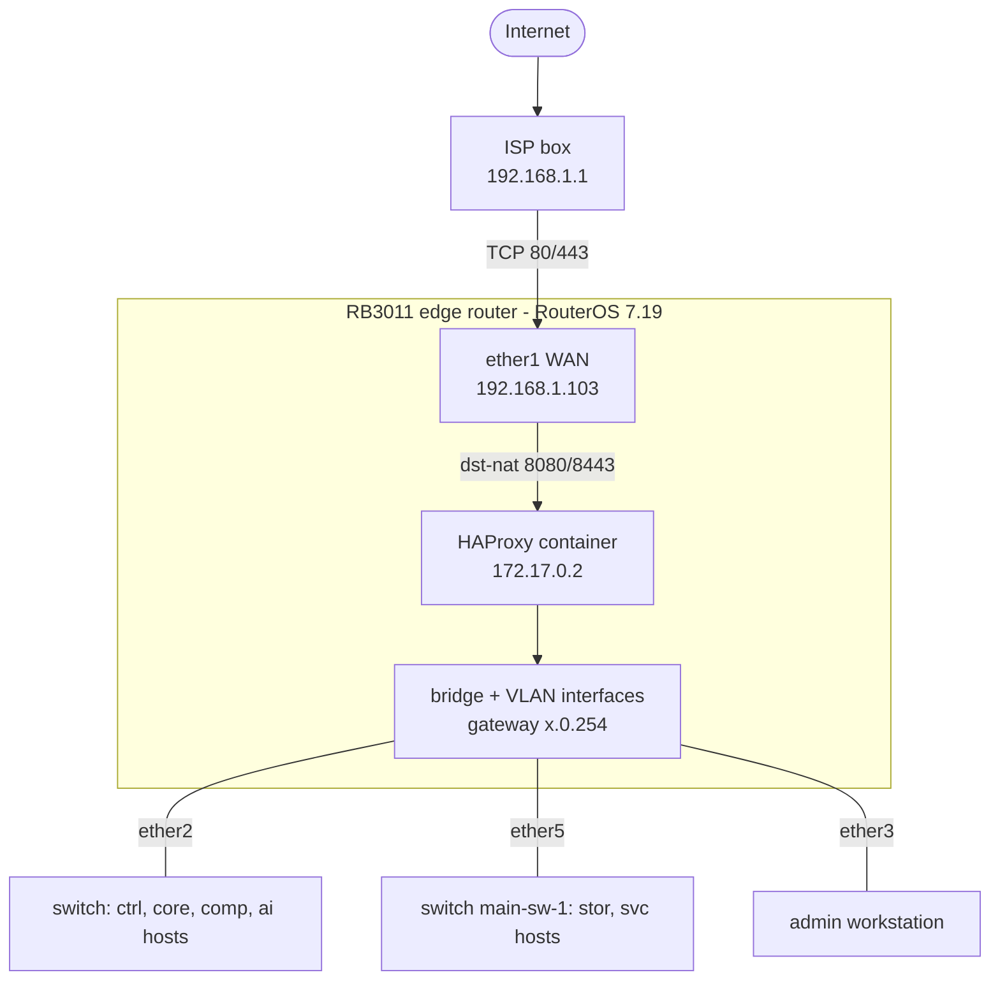

# Phorge infrastructure architecture

How the Phorge infrastructure fits together and how this repository relates to the other two. Written from the live router (RouterOS 7.19, observed on 2026-09-20), the OpenTofu configuration, and the [FrontPlane](https://github.com/phorge-fr/Frontplane) and [Ansible](https://github.com/phorge-fr/Ansible) repositories. When a fact changes, fix it here in the same change.

The facts (addresses, VLANs, hosts, flows) are in [the network plan](../reference/network-plan.md).

## Repositories

| Repository | Owns | Tooling |
|---|---|---|
| **Network** (this one) | The edge router: VLANs, addressing, DHCP, DNS, firewall, NAT, and the HAProxy container that publishes services | OpenTofu, RouterOS scripts |
| **FrontPlane** | The three k0s Kubernetes clusters `control`, `core` and `svc` and everything that runs in them | FluxCD, SOPS + age, k0sctl, Cilium |
| **Ansible** | Everything that is not Kubernetes: the storage node, the HPC nodes, the Incus compute nodes, SSH hardening, and the host firewalls | Ansible, Vault |

A flow between two VLANs has to be allowed in up to three places: the router (`firewall_rules` in [terraform.tfvars](../../terraform.tfvars)), the host firewall (`firewall_allowed_ports` in the Ansible inventory) and, for pod traffic, a NetworkPolicy in FrontPlane. See the [checklists](../how-to/change-the-network.md).

## Topology

- The router is the only gateway. `ether1` is a DHCP client of the ISP box. The ISP box forwards TCP 80 and 443 to the router, which dst-NATs them to a HAProxy container running on the router itself (bridge `containers`, 172.17.0.0/24).
- The `bridge` carries the management LAN untagged (192.168.2.0/24) and the workload VLANs 20 to 80 as tagged sub-interfaces. VLAN filtering is off: every bridge port carries every VLAN, and isolation between VLANs is done by routing and the firewall on the router only.
- The VLAN interfaces use MTU 8152, so the bridge and every physical port under it need an L2MTU of at least 8156 (the bridge L2MTU is the lowest of its ports). [base_configuration.rsc](../../defaults/base_configuration.rsc) sets `l2mtu=8156` and `mtu=8156` on every Ethernet port.
- The RB3011 has two switch chips (`ether1` to `ether5` on `switch1`, `ether6` to `ether10` on `switch2`). Traffic between the two groups is bridged by the CPU.

## DNS, TLS, and secrets

**DNS.** The router is the resolver of every VLAN (DHCP hands out `x.0.254`). It forwards to 1.1.1.1 and to the ISP box learned by DHCP. Static records for the nodes (`*.phorge`) and the three `*.core.phorge` aliases live in `dns_records`. Public `phorge.fr` names are on Cloudflare.

**TLS.**

- Public hostnames: Let's Encrypt through cert-manager (`public-issuer`, DNS-01 with a Cloudflare token) on `traefik-public`.
- Internal hostnames: `local-root-ca`, a self-signed ECDSA CA issued by cert-manager (10 years) that signs `*.core.phorge`. Its certificate is copied to the storage node as `alloy_ca_cert`.
- The router has its own CA (`Phorge-Core-0`, RSA 2048, valid to 2036) that signs the certificate of its HTTPS service (`router-https`, with `IP:192.168.2.254`, `core0.phorge` and `main-gw-0.phorge` as subject alternative names), which is the REST API OpenTofu talks to. The provider verifies it against `certs/router-ca.pem`, a local file that is not committed.

**Secrets.** FrontPlane uses SOPS with age. Ansible uses Vault (inline `!vault` values, whole-file encryption for `.env` files). This repository keeps RouterOS credentials in `.env` (ignored) and the state in a local file (ignored) that OpenTofu encrypts with a passphrase kept in `.env`. All three GitHub repositories are public: commit ciphertext only, never plaintext.

## Related

- [Known inconsistencies](known-inconsistencies.md)
- [Change the network](../how-to/change-the-network.md)
