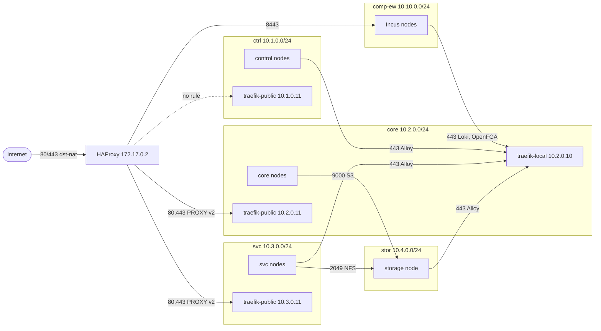

# Network plan

Observed on the live router (RouterOS 7.19) and in the OpenTofu configuration. [How it fits together](../explanation/architecture.md).

## Network plan

| Segment | VLAN | Subnet | Router address | Interface list | DHCP pool | Members |
|---|---|---|---|---|---|---|
| Management | untagged on `bridge` | 192.168.2.0/24 | 192.168.2.254 | `LAN` | 192.168.2.1-10 | admin workstation, switches (`main-sw-0` .253, `main-sw-1` .252) |
| ctrl | 20 | 10.1.0.0/24 | 10.1.0.254 | `phorge` | 10.1.0.1-253 | control cluster |
| core | 30 | 10.2.0.0/24 | 10.2.0.254 | `phorge` | 10.2.0.1-253 | core cluster |
| svc | 40 | 10.3.0.0/24 | 10.3.0.254 | `phorge` | 10.3.0.1-253 | svc cluster |
| stor | 50 | 10.4.0.0/24 | 10.4.0.254 | `phorge` | 10.4.0.1-253 | storage node |
| ai | 60 | 10.5.0.0/24 | 10.5.0.254 | `phorge` | 10.5.0.1-253 | HPC nodes |
| comp-ew | 70 | 10.10.0.0/24 | 10.10.0.254 | `phorge` | 10.10.0.1-253 | Incus compute nodes (east-west) |
| comp-ns | 80 | 10.11.0.0/24 | 10.11.0.254 | `phorge` | none | Incus north-south: external addresses of the OVN routers (`ipv4.ovn.ranges` 10.11.0.10-250 on the Incus `UPLINK`) |
| containers | bridge | 172.17.0.0/24 | 172.17.0.1 | `Containers` | none | HAProxy (`veth1`, 172.17.0.2) |
| WAN | `ether1` | 192.168.1.0/24 | 192.168.1.103 (DHCP) | `WAN` | none | ISP box 192.168.1.1 |

**10.12.0.0/24 is not a VLAN.** It is the routed prefix for Incus network forwards and load balancers: the Incus `UPLINK` lists it in `ipv4.routes`, Incus announces each forward or load balancer address (a /32) over BGP with the OVN router address on comp-ns as next hop, and the router learns them through `bgp_connections`. The router has no interface, gateway or DHCP in it, so nothing answers for an address that is not announced. Exposing one to the Internet is a dst-NAT or an HAProxy backend towards that address, plus the forward rule that allows it.

Address conventions inside each cluster VLAN:

| Address | Use |
|---|---|
| `.1` to `.3` | The three nodes |
| `.4` | Kubernetes API virtual IP (Keepalived, VRRP) |
| `.10` | `traefik-local`, the internal ingress |
| `.11` | `traefik-public`, the ingress that HAProxy forwards to |
| `.13` | Forgejo SSH (svc only) |
| `.10` to `.20` | Cilium L2 load balancer pool |
| `.254` | Router |

Address lists used by the firewall: `ctrl-nodes` 10.1.0.1-3, `core-nodes` 10.2.0.1-3, `svc-nodes` 10.3.0.1-3, `stor-nodes` 10.4.0.1, `ai-nodes` 10.5.0.1-2, `comp-nodes` 10.10.0.1-3, and `container-ips` (the addresses of the veths, 172.17.0.2 today, derived from `veths`).

Firewall model:

1. **input**: only the `LAN` interface list reaches the router itself. The `phorge` VLAN interfaces also get DNS (TCP and UDP 53), the `core-nodes` get the RouterOS API over TLS (TCP 8729, `api-ssl`, read-only `mktxp` user: the metrics exporter of Frontplane; the service itself is set by hand, see the runbook), and ICMP is accepted from everywhere. Containers and the WAN side get nothing else.
2. **forward**: accepted by default. Explicit drops, in order: invalid connections, new connections from `WAN` that were not dst-NATed, anything not from `LAN` towards 192.168.2.0/24 or 192.168.1.0/24, `Containers` to `phorge` (silent), everything else from `Containers` (logged as `ctr-drop`), `phorge` to `phorge`. Allowed exceptions from `terraform.tfvars` are inserted above the drops.
3. **Containers are treated as compromisable.** `containers-anti-spoof` sits above every accept and drops (logged as `ctr-spoof`) any packet that leaves the `containers` bridge with a source outside `container-ips`; the address-based accepts below it do not match an interface, so without it a container could borrow a node's address. What a container may then reach is exactly the two accepts to the core and svc ingresses on TCP 80 and 443, and each of them is also bound to `container-ips`. The masquerade rule stays: Traefik trusts PROXY headers only from the router address of its VLAN.
4. **Result**: VLAN to VLAN is denied unless listed, the management LAN reaches everything, VLANs reach the Internet, containers reach only the two ingresses, and the Internet only reaches TCP 80 and 443 through the dst-NAT rules.

## Physical wiring

Observed on 2026-09-20 from the link state and the bridge host table. Check it again after any recabling.

| Port | Chip | State | What sits behind it |
|---|---|---|---|
| `ether1` | switch1 | 1 Gbps | ISP box 192.168.1.1 (WAN) |
| `ether2` | switch1 | 1 Gbps | A switch carrying the control and core nodes, one Incus node, and the GPU host |
| `ether3` | switch1 | 1 Gbps | Admin workstation |
| `ether4` | switch1 | no link | Spare |
| `ether5` | switch1 | 1 Gbps | Switch `main-sw-1` (192.168.2.252) with the storage node and the svc nodes behind it |
| `ether6` to `ether9` | switch2 | no link | Spare |
| `ether10` | switch2 | no link | Intended uplink to the managed switch. PoE-out is `auto-on` on this port only. Down on this date |
| `sfp1` | none | no link, no module | Spare |

## Hosts and clusters

| Group | Hosts | Addresses | Role | Managed by |
|---|---|---|---|---|
| control | `ctrl-rpi4-01` to `03` | 10.1.0.1-3 | k0s controller+worker | FrontPlane, Ansible (hardening, firewall) |
| core | `core-wyse-01` to `03` | 10.2.0.1-3 | k0s controller+worker | FrontPlane, Ansible |
| svc | `svc-rock64-01` to `03` | 10.3.0.1-3 | k0s controller+worker | FrontPlane, Ansible |
| storage | `stor-rpi5-01` | 10.4.0.1 | RAID 5 on 4 NVMe (`/mnt/main`), NFS export, rustfs S3 | Ansible |
| hpc-gpu | `ai-z440-01` | 10.5.0.4 (DHCP lease) | GPU node (ROCm/NVIDIA drivers, Docker) | Ansible |
| hpc-npu | `ai-rpi5-01` | 10.5.0.1 | NPU node | Ansible |
| compute | `comp-opti-01` to `03` | 10.10.0.1-3 | Incus cluster | Ansible (SSH, firewall, Incus, Ceph, OVN, Alloy) |

All three clusters run the same stack: k0s 1.36.4, Cilium 1.19.2 as CNI with kube-proxy disabled and L2 announcements for load balancer IPs, a Keepalived virtual IP for the API, pod CIDR 10.244.0.0/16 and service CIDR 10.96.0.0/12. Flux reconciles `clusters/<name>` from FrontPlane.

| Cluster | Purpose | Workloads |
|---|---|---|
| control | Entry point: resource provisioning, AI model gateway, infrastructure frontend | cert-manager, Traefik (local + public), Alloy, Crossplane, csi-driver-nfs, kube-state-metrics |
| core | Critical internal services | cert-manager, Traefik, Alloy, Longhorn, Authentik, kube-prometheus-stack (Prometheus, Alertmanager, Grafana), Loki, OpenFGA, Uptime Kuma |
| svc | Public end-user services | cert-manager, Traefik, Alloy, csi-driver-nfs, Forgejo, kube-state-metrics |

The storage node exports `/mnt/main/csi-svc` over NFSv4 to the three svc nodes and runs rustfs (S3 on 9000, console on 9001).

## Services and public hostnames

| Hostname | Cluster | Service | Reached through |
|---|---|---|---|
| `auth.phorge.fr` | core | Authentik (OIDC SSO) | HAProxy, `traefik-public` 10.2.0.11 |
| `monitoring.phorge.fr` | core | Grafana | HAProxy, `traefik-public` 10.2.0.11 |
| `status.phorge.fr` | core | Uptime Kuma | HAProxy, `traefik-public` 10.2.0.11 |
| `api.phorge.fr` | control | Phorge API (`/v1`, OpenAPI and Swagger UI only) | HAProxy, `traefik-public` 10.1.0.11 |
| `cap.phorge.fr` | core | Cap (captcha of the Authentik sign-in, only `/assets` and the site key are public) | HAProxy, `traefik-public` 10.2.0.11 |
| `git.phorge.fr` | svc | Forgejo | HAProxy, `traefik-public` 10.3.0.11 |
| `iaas.phorge.fr` | compute | Incus API and UI | HAProxy SNI routing to 10.10.0.1-3:8443 (rule `Allow Hproxy to Incus cluster API`, see [flows](#traffic-flows)) |
| `prometheus.core.phorge`, `loki.core.phorge`, `openfga.core.phorge` | core | Prometheus, Loki, OpenFGA | `traefik-local` 10.2.0.10, internal CA, basic auth |
| `crossview.control.phorge` | control | Crossview (Crossplane UI, authentik SSO) | `traefik-local` 10.1.0.10, internal CA |

Forgejo also serves Git over SSH on 10.3.0.13:22, internal only.

HAProxy ([templates/haproxy.cfg.tftpl](../../templates/haproxy.cfg.tftpl)) routes plain HTTP on 8080 (redirect to HTTPS for the seven known hosts, everything else to the control ingress) and TLS on 8443 by SNI without terminating it: `iaas` to the Incus nodes, `api` to the control ingress, `auth`, `monitoring`, `status` and `cap` to the core ingress, `git` to the svc ingress, anything else to the control ingress. A change to the file is picked up by the running container without a restart. HAProxy runs as uid 99 with no capability although the container user is `0:0`, and the image is pinned by digest (see the runbook). The ingress addresses and the Incus node addresses are not typed in the template: they come from `networks` (`ingress` and `nodes`), and the rules that let the container reach the ingresses use the same data.

Client addresses reach the ingresses through the PROXY protocol v2. HAProxy traffic is masqueraded by the router (NAT rule for 172.17.0.0/24), so each Traefik trusts PROXY headers only from the router address of its VLAN (`x.0.254/32`, set in `overlays/*/controllers/traefik/traefik-public-patch.yml`). Changing that NAT rule, the HAProxy source or the Traefik `trustedIPs` breaks client address preservation.

## Traffic flows

Dotted arrows are flows that the architecture asks for but the firewall does not allow.

| Flow | Port | Router rule | Status |
|---|---|---|---|
| Internet to HAProxy | TCP 80, 443 to 8080, 8443 | two dst-NAT rules | allowed |
| HAProxy to core ingress 10.2.0.11 | TCP 80, 443 | `Allow Hproxy to core cluster Ingress` | allowed |
| HAProxy to svc ingress 10.3.0.11 | TCP 80, 443 | `Allow Hproxy to svc cluster Ingress` | allowed |
| HAProxy to control ingress 10.1.0.11 (default backend) | TCP 80, 443 | none | blocked by `Drop Containers to phorge` |
| HAProxy to Incus 10.10.0.1-3 (backend and health checks) | TCP 8443 | `Allow Hproxy to Incus cluster API` | allowed |
| ctrl, svc, stor nodes to core `traefik-local` (Alloy metrics and logs) | TCP 443 | three `push metrics/logs to core` rules | allowed |
| svc nodes to storage (NFS) | TCP 2049 | `NFS/TCP` rule | allowed |
| svc nodes to storage (NFS) | UDP 2049 | `NFS/UDP` rule | allowed, unused: NFSv4 uses TCP and the host firewall only opens TCP |
| core nodes to rustfs S3 (Longhorn backups) | TCP 9000 | `rustfs S3` rule | allowed; the backup target is not defined in FrontPlane yet |
| Management LAN to every VLAN | any | none needed | allowed; the host firewalls then restrict SSH, 6443, 9443, 9000, 9001 |
| Any VLAN to the router | TCP and UDP 53, ICMP | two DNS input rules | allowed |
| VLANs to the Internet | any | masquerade | allowed: image pulls, ACME, GitHub (Flux, Renovate), Cloudflare API |
| svc (Forgejo) to `auth.phorge.fr` (OIDC) | TCP 443 | none towards core | resolves through public DNS and leaves through the WAN, so it depends on NAT hairpin at the ISP box: to verify |
| Incus nodes to core `traefik-local` (Loki logs and events, OpenFGA authorization; Alloy metrics and logs) | TCP 443 | `incus-comp-to-core` | allowed |
| Incus nodes to the router (BGP) | TCP 179 | `bgp-from-comp` (input chain) | allowed |
| Control cluster to the LLM gateway (LiteLLM, TCP 4000) on the HPC node | TCP 4000 | none | implied by the control cluster role and the `hpc-servers` role, which is not wired yet |
